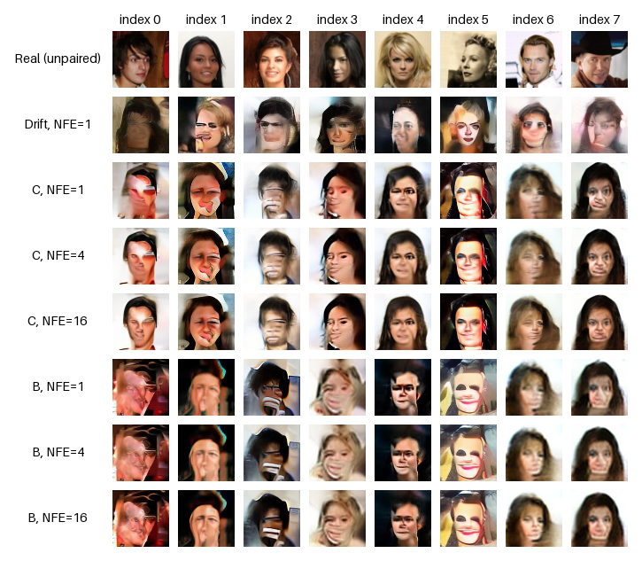

# Self-Induced Flow Maps via Drifting

**Yentl Collin · Generative modeling research**

I studied how drifting signals can train a reusable two-time transport map,
`Φθ(x, a, b)`. The model produces its own intermediate states, learns local
transitions from those states, and composes the same map at inference.
The project also includes a one-step direct-RGB drifting generator.

[Theory and objectives — PDF](docs/main.pdf) ·
[Experiments and results — PDF](docs/rapport_celeba_clair.pdf)

## Latest result: one-step drifting versus diffusion

**On CelebA test, the one-step drifting generator reaches FID 5.809,
compared with 5.780 for the diffusion reference at 250 model evaluations.**
The validation result is FID 6.015 versus 6.065 for the same checkpoints.

| Evaluation | Model | NFE | FID ↓ | KID ↓ |
|---|---|---:|---:|---:|
| Official validation | **GMD** | **1** | **6.014798** | **0.002151156** |
| Official validation | Diffusion | 250 | 6.065266 | 0.003761395 |
| Official test | **GMD** | **1** | **5.808974** | **0.001944101** |
| Official test | Diffusion | 250 | 5.779964 | 0.003332478 |

This is numerically comparable test FID, with a 0.50% gap and lower KID for GMD.
GMD's validation FID is 0.83% lower. Both models use EMA weights and the same
evaluation settings within each split: 19,867 images on validation and 19,962
on test. The checkpoints were fixed for the recorded test comparison.

GMD was trained for 225,000 updates and diffusion for 50,000: this is a quality
comparison at different inference budgets, not a matched-training-compute study.
There is one GMD training seed; numerical proximity does not establish statistical
equivalence, and NFE does not directly measure wall-clock speed.

[Full-precision measurements and protocol](results/drifting_vs_diffusion.json)
come from the archived **21 September 2026** reports. The PDFs linked above
cover the methodology and earlier studies.

The one-step result uses the [RGB backbone](flowmaps/models/backbone.py),
[drifting objective](flowmaps/objectives/drifting.py) and
[frozen feature stack](flowmaps/features/combined.py).
The two-time Flow–GMD extension below is a separate experiment.

## Start here

| Read in this order | What it explains |
|---|---|
| **1. [Drifting signal](flowmaps/objectives/drifting.py)** | The distributional force used as a detached target. |
| **2. [Self-induced states](flowmaps/objectives/self_induced.py)** | How the map generates its own training states and combines path, boundary and composition signals. |
| **3. [Local feature-space loss](flowmaps/objectives/local_drifting.py)** | How the RGB experiment supervises a short transition from a model-reached state. |
| **4. [Two-time model](flowmaps/models/rgb.py)** | The map parameterization and exact identity on the diagonal. |
| **5. [Composition](flowmaps/models/rollout.py)** | Composing transitions and evaluating structural constraints. |

The historical kernel-WGF construction is in
[objectives/wgf.py](flowmaps/objectives/wgf.py). Its training path uses raw
latent geometry; the RGB path uses frozen MAE and ConvNeXt features.

```text
noise z ── Φθ(·, 0, a) ──► model-induced state xa ── Φθ(·, a, b) ──► xb
                                  │
                         detached drifting target
```

The learned composition relation is
`Φθ(Φθ(z, 0, a), a, b) ≈ Φθ(z, 0, b)`.
“Self-induced” refers to using `xa = Φθ(z, 0, a)` as a training state.
The map is the identity on the diagonal; composition is learned approximately.

## Code organization

```text
flowmaps/
  objectives/    Drifting, WGF, local and structural losses
  models/        RGB and latent maps, shared backbone, composed rollout
  features/      Frozen MAE + ConvNeXt feature extraction
  training/      Two trainers: latent.py and rgb.py; shared training helpers
  data/          Dataset loading, latent preparation and cache I/O
  evaluation/    Sample generation and FID/KID metrics
examples/
  toy.py         Small synthetic experiment
  mnist.py       MNIST experiment
```

There are **two CelebA training entry points**:

- [training/latent.py](flowmaps/training/latent.py): the historical WGF flow map
  in a frozen VAE's latent space.
- [training/rgb.py](flowmaps/training/rgb.py): structural E10 with local
  feature-space drifting, directly on RGB images.

The many historical continuation and ablation trainers are omitted. Their
results and the comparisons with Lagrangian self-distillation remain in the PDFs.

## Flow-map experiments

The learned two-time maps were also evaluated under the protocols below.
These studies are separate from the one-step GMD benchmark above.

### Direct-RGB Flow–GMD with local drifting

The experiment report (§11.12) records a structural E10 checkpoint followed by
50 updates at learning rate `5e-6` and local feature-GMD weight `0.005`.
These measurements use **one training seed and three generation seeds**;
the small deviations below describe generation variability only.

| NFE | Raw-weight FID ↓ | KID ↓ |
|---:|---:|---:|
| 1 | 7.8012 ± 0.0008 | 0.0028401 |
| 2 | 7.5574 ± 0.0006 | 0.0026512 |
| 16 | 7.5499 ± 0.0010 | 0.0026416 |

The paired ablation attributes most of the absolute FID improvement to the
short low-learning-rate continuation. The local loss contributes especially
to KID and the paired improvements at NFE 1 and 16. The full report also
contains the LSD, anchor and unsuccessful direct-RGB comparisons.

These are development experiments, not an untouched-test or state-of-the-art
claim. More inference steps are not guaranteed to improve a learned map.

<details>
<summary>Earlier latent WGF study: three training seeds and fixed qualitative grid</summary>

### Historical latent WGF confirmation

CelebA-64 in a frozen VAE's 256-dimensional latent space; 5,000 updates,
three training seeds and 4,999 generated images per evaluation.
The historical 30,000-image cache uses indices `[5000, 30000)` for training;
the first 5,000 images, minus duplicate index 652, form the reused development reference.
`±` denotes sample standard deviation across the **three training seeds**.

| Method | NFE | FID ↓ | KID × 1,000 ↓ |
|---|---:|---:|---:|
| Optimizer-time drifting | 1 | 66.020 ± 1.002 | 56.241 ± 1.383 |
| Core C flow map | 1 | 61.556 ± 0.590 | 52.714 ± 0.374 |
| Core C flow map | 4 | **45.762 ± 1.513** | **33.716 ± 1.306** |
| Core C flow map | 16 | 46.101 ± 0.685 | 33.143 ± 0.807 |
| Core C + Eulerian regularization | 4 | 45.906 ± 2.293 | 34.691 ± 2.142 |

Four calls improve on one in this experiment; sixteen do not further improve
mean FID. The Eulerian variant does not establish an advantage over Core C.



Original grid, unchanged: training seed 42 and fixed sample indices 0–7.
Generated columns share prior draws; the real reference row is unpaired.

</details>

## Run

Install a suitable PyTorch build, then install this package (Python 3.10+):

```bash
python -m pip install -e '.[test]'
python -m pytest -q
```

The reorganized package passes **231 tests** for the retained methods. The seven
CLI entry points and the tiny CPU example below were also checked.

Start with a tiny CPU run, without data or pretrained weights:

```bash
python -m examples.toy --method fast_wgf_flow_map --target gaussian \
  --steps 2 --batch 16 --hidden 32 --diag-batch 64 --device cpu
```

For CelebA, inspect the two training interfaces:

```bash
python -m flowmaps.training.latent --help
python -m flowmaps.training.rgb --help
```

The latent recipe requires your CelebA data and a local frozen VAE:

```bash
python -m flowmaps.data.prepare_latents \
  --data-root data/celeba64 \
  --vae-model data/models/sd-vae-ft-mse \
  --output data/celeba64_latents_sdvae_ft_mse.pt

torchrun --standalone --nproc_per_node=8 --module flowmaps.training.latent \
  --device cuda --run-dir runs/latent_wgf/core_seed42 --seed 42 --deterministic
```

The RGB continuation requires the corresponding parent checkpoints and frozen
MAE/ConvNeXt assets. Their original identity checks are retained. Data, pretrained
weights and training checkpoints are not bundled. The source layout and source
signatures have changed; use a new run when adapting this checkout.

Generation and metrics are in [evaluation/generate.py](flowmaps/evaluation/generate.py)
and [evaluation/metrics.py](flowmaps/evaluation/metrics.py).

## Background

This work builds on [Generative Modeling via Drifting](https://arxiv.org/abs/2602.04770),
[Learning flow maps via self-distillation](https://arxiv.org/abs/2505.18825), and
[A Long-Short Flow-Map Perspective for Drifting Models](https://arxiv.org/abs/2602.20463).
The PDFs distinguish prior methods from the implementations and ablations
studied here. Datasets and pretrained models retain their original usage terms.
